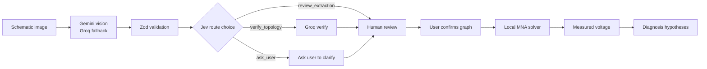

# Ohmni

**Photo of a circuit in, testable diagnosis out. Several models, one deterministic solver, a human in the loop.**

Live: https://multimodal-hackathon-sage.vercel.app (no signup) · Demo flow: [docs/DEMO_SCRIPT.md](docs/DEMO_SCRIPT.md)

## The problem

You build a simple low-voltage circuit, measure 0.45 V where the schematic says 2.50 V, and have no fast way to reconcile the drawing, the reading and the likely mistake. Ohmni reads the schematic image, lets you confirm the connections, computes the expected behavior exactly, and turns your measurement into ranked, testable hypotheses with a safe next measurement.

Willingness to pay and time saved are hypotheses, not validated claims (see [docs/PRD.md](docs/PRD.md)).

## How it works

1. **Upload** a PNG/JPEG/WebP schematic (up to 5 MB) at `/lab`, or load the built-in divider sample.
2. **Gemini** (`gemini-3.5-flash`) reads the image and returns a *candidate* circuit graph as JSON. If Gemini is rate-limited, over quota, unavailable, times out, errors, is unconfigured or returns malformed output, Groq `qwen/qwen3.8-27b` reads the image once instead ([docs/VISION_FALLBACK.md](docs/VISION_FALLBACK.md)).
3. **Zod + structural validation** checks the candidate. Hard invalidity always forces correction.
4. **Jev** (`jev-1.13-free`) receives only the structured summary and picks a route: `review_extraction`, `verify_topology` or `ask_user`.
5. The app dispatches the route: show it for review, run the Groq topology verifier, or ask the user to clarify.
6. **You review and confirm** the graph (editable values and nodes). The server refuses to solve without `userConfirmed: true`.
7. A **local MNA solver** (pure TypeScript) computes node voltages and currents.
8. You enter a **measured voltage**; the diagnosis step tests bounded alternate resistor hypotheses against it and proposes a next measurement.



## Why multimodel

| Model | Role | Never does |
|---|---|---|
| Gemini `gemini-3.5-flash` | Reads pixels, proposes a candidate graph | Decide trust, do the math |
| Jev `jev-1.13-free` (BeatAPI) | Chooses the route from structured state (one decision per analysis) | See pixels, solve equations |
| Groq `qwen/qwen3.8-27b` | Fallback reader and topology verifier (a Preview model on Groq's free plan) | Override hard validation |
| Local MNA solver | The only authority for voltages and currents | Trust an image |

Two models agreeing is not proof of electrical correctness, which is why a human confirmation gate sits before the solver. Development-time Claude Code / ChatGPT Work activity is not counted as runtime multimodel.

Measured on production (2026-10-11, clean 10k/10k divider): Gemini extraction ok in 3790 ms (1310 in / 106 out tokens) with an exact graph; Jev ok in 440 ms, `review_extraction`, p=1.00; `/api/solve` gave VOUT 2.5 V, and a measured 0.45 V ranked "R2 may be 1 kΩ instead of 10 kΩ" first. Evidence ledger: [docs/MODEL_ACCESS.md](docs/MODEL_ACCESS.md).

## Trust and safety

- No fabricated traces: every model event shows the actual provider, model, status, latency and tokens returned. Failures and skips are shown as such.
- User confirmation is required before any solve.
- Output is **hypotheses, not verdicts**; the UI tells you to disconnect power before measuring resistance.
- Keys are server-only; uploads are bounded and not persisted by default; no mains or high-voltage guidance.
- Note provider free-tier data-use terms before uploading confidential designs.

## Free-plan operation and limits

All runtime model calls use free plans: Gemini free tier, Groq free plan, Jev `jev-1.13-free`. The paid Jev id is refused in code, and billing is never enabled. Jev's free tier allows 1 successful call per minute, so the app paces it (skips with an honest `skipped` trace if the slot is not near) and honors `Retry-After` on HTTP 429.

Unit economics: free-plan charges are $0 by construction, which is **not** a production marginal-cost claim. Cost per successful diagnosis, savings from routing and accuracy are not yet measured. See [docs/UNIT_ECONOMICS.md](docs/UNIT_ECONOMICS.md).

## Run locally

```bash
npm i
cp .env.example .env.local   # fill GEMINI_API_KEY, GEMINI_MODEL=gemini-3.5-flash, BEATAPI_API_KEY, ...
npm run dev                  # http://localhost:3000
npm test                     # vitest
npm run lint
npm run smoke                # production smoke checks; add `-- --live` for one real extract call
```

Without keys, the sample and manual divider still solve locally; extraction reports an honest error and routes to `ask_user`.

## API

| Endpoint | Purpose |
|---|---|
| `POST /api/extract` | multipart `image` → `{ extraction, route, trace }` (400/413/429 typed errors; extraction failure returns `ask_user`) |
| `POST /api/solve` | `{ graph, userConfirmed: true, measuredVoltage? }` → `{ result: { voltages, currents, hypotheses, trace } }` (422 `NOT_CONFIRMED` / `INVALID_GRAPH` / `UNSOLVABLE`) |
| `POST /api/probe` | Probe Guide: `{ graph, userConfirmed: true, observations? }` → ranked single-fault hypotheses and the next node to probe, computed by the solver (no model calls). Backend ready, UI pending ([docs/MOONSHOT.md](docs/MOONSHOT.md)) |
| `GET /api/health` | `{ status, build, providers: { gemini, groq, jev } }` (configured flag and model id per provider; never key values) |

Wire shapes: [docs/API_CONTRACT.md](docs/API_CONTRACT.md).

## Tech stack

Next.js 16 (App Router, Node route handlers), React 19, TypeScript, Tailwind 4, Zod 4, `@google/genai`, Vitest, deployed on Vercel. Architecture: [docs/ARCHITECTURE.md](docs/ARCHITECTURE.md).

## Limitations

- DC resistive circuits only: resistors and DC voltage sources.
- No breadboard photo recognition yet (clean schematics; breadboards need confirmed connections).
- Free-tier rate limits and provider availability apply: Gemini returned 503s during testing (hence the pinned model) and its free quota can be exhausted (429), in which case Groq (about 3 extractions/min on its free plan) takes over; Jev allows 1 call/min. The public demo also enforces per-IP limits (extract 6/min and 40/h, solve 60/min, 413 above 6 MB).
- Probe Guide (`POST /api/probe`) is backend-only so far; the lab UI does not call it yet.
- Test fixtures and demo samples are synthetic clean renders; accuracy on real photos is not measured.
- Floating, singular or malformed networks are rejected, not guessed.

## Credits

Built for the BuilderBase SF Tech Week multimodel hackathon with Claude Code and ChatGPT Work as development tools (not runtime models). Providers: Google Gemini, Jev via BeatAPI, GroqCloud.
