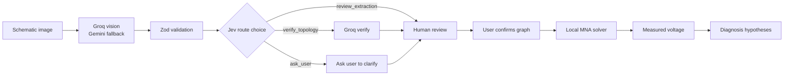

# Ohmni

**Photo of a circuit in, testable diagnosis out. Several models, one deterministic solver, a human in the loop.**

Primary: [Anbaric Cloud](https://ohmni.cloud.anbaric.ai) (Anbaric login or organizer access required) · Public fallback: [Vercel](https://multimodal-hackathon-sage.vercel.app) · [Release demo](docs/DEMO_SCRIPT.md)

## Source and release status

Main `1ec8a79` includes the four-stage Lab, Probe Guide, grounded tutor and **The Living Schematic** from [merged #67](https://github.com/dude297/Ohmni/pull/67), integrated with experimental workspaces in [merged #69](https://github.com/dude297/Ohmni/pull/69). Hosted builds can differ from source: the last public-host verification in the [release evidence ledger](docs/RELEASE_E2E_2026-10-11.md) observed Vercel build `d5a0035`, which predates these changes. Read that dated evidence before claiming deployment parity.

The Living Schematic's exact-build tests cover its circuit hero, measurement comparison and Advanced bridge entry. They do not verify every later integration route or an updated production deployment. Main CI passes **630 tests, with 7 expected failures and 2 skipped tests**; expected failures remain known limitations. See [current state](docs/CURRENT_STATE.md), [UI validation](docs/ui-review/LIVING_SCHEMATIC.md) and the [documentation index](docs/README.md). This documentation update does not merge or deploy application changes.

## The problem

You build a simple low-voltage circuit, measure 0.45 V where the schematic says 2.50 V, and have no fast way to reconcile the drawing, the reading and the likely mistake. Ohmni reads the schematic image, lets you confirm the connections, computes the expected behavior exactly, and turns your measurement into ranked, testable hypotheses with a safe next measurement.

Willingness to pay and time saved are hypotheses, not validated claims (see [docs/PRD.md](docs/PRD.md)).

## How it works

1. **Capture** a PNG/JPEG/WebP schematic (up to 5 MB) at `/lab`, or load a prepared circuit. Start with `/lab?sample=divider` or the 12 V bridge at `/lab?sample=advanced`. Prepared graphs are labelled and do not call image models.
2. **Groq** (`qwen/qwen3.8-27b`) reads the image and returns a *candidate* circuit graph as JSON. Rate limits, exhausted quota, model unavailability, timeout, server errors, missing configuration or malformed output allow one **Gemini** (`GEMINI_MODEL`) fallback attempt. Other failures return manual recovery. Order is configurable (`VISION_PRIMARY=groq|gemini`); the Groq-first default follows our dated synthetic-fixture comparison ([docs/VISION_FALLBACK.md](docs/VISION_FALLBACK.md)), not a real-photo accuracy claim.
3. **Zod + structural validation** checks the candidate. Hard invalidity always forces correction.
4. **Jev** (`jev-1.13-free`) receives only the structured summary and picks a route: `review_extraction`, `verify_topology` or `ask_user`.
5. The app dispatches the route: show it for review, run the Groq topology verifier, or ask the user to clarify.
6. **Review and confirm** the graph (editable values and nodes). The server refuses to solve without `userConfirmed: true`. Editing the circuit clears confirmation and earlier solve/probe results.
7. **Compare** against the server's deterministic MNA solver (pure TypeScript). The homepage has a labelled browser-only divider preview; the Lab's optional local fallback supports only the divider. Advanced networks require server MNA.
8. You enter a **measured voltage**; the diagnosis step tests bounded alternate resistor hypotheses against it and proposes a next measurement.
9. **Investigate** with Probe Guide (in `/lab`, and standalone at `/probe`): it re-solves candidate single faults and recommends a node from the current observations. The optional grounded **tutor** (`/probe`, Gemini) explains solver-checked numbers only when requested.



## Why multimodel

| Model | Role | Never does |
|---|---|---|
| Groq `qwen/qwen3.8-27b` | Primary reader and topology verifier (a Preview model on Groq's free plan) | Override hard validation |
| Jev `jev-1.13-free` (BeatAPI) | Chooses the route from structured state (one decision per analysis) | See pixels, solve equations |
| Gemini (`GEMINI_MODEL`) | Fallback reader when Groq fails; tutor explanations (numbers checked against the solver) | Decide trust, do the math |
| Local MNA solver | The only authority for voltages and currents | Trust an image |

Two models agreeing is not proof of electrical correctness, which is why a human confirmation gate sits before the solver. Development-time Claude Code / ChatGPT Work activity is not counted as runtime multimodel.

Measured on the Vercel host (2026-10-11 12:51 PDT, earlier build `d1096b7`, clean 10k/10k divider `public/samples/clear-divider.png`): Groq extraction ok in 839 ms (1208 in / 211 out tokens) with an exact graph; Jev ok in 711 ms, `review_extraction`, p=1.00. A minute later Groq returned 429 on `ambiguous-smudged.png`, Gemini `gemini-3.5-flash-lite` took over (1140 ms) and Jev chose `ask_user` (recorded: [docs/demo/README.md](docs/demo/README.md)). Earlier, Gemini-primary run: Gemini ok in 3790 ms, Jev 440 ms `review_extraction`; `/api/solve` gave VOUT 2.5 V, and a measured 0.45 V ranked "R2 may be 1 kΩ instead of 10 kΩ" first. Evidence ledger: [docs/MODEL_ACCESS.md](docs/MODEL_ACCESS.md).

## Trust and safety

- No fabricated traces: every model event shows the actual provider, model, status, latency and tokens returned. Failures and skips are shown as such.
- User confirmation is required before any solve.
- Output is **hypotheses, not verdicts**; the UI tells you to disconnect power before measuring resistance.
- Keys are server-only; uploads are bounded and not persisted by default; no mains or high-voltage guidance.
- Note provider free-tier data-use terms before uploading confidential designs.

## Free-plan operation and limits

The hackathon configuration uses the recorded free-tier provider choices and Jev `jev-1.13-free`; other Jev model IDs are refused in code. Model configuration does not establish an account's billing state or future pricing. Jev pacing follows the recorded one-successful-call-per-minute limit, skips honestly when no slot is available, and honors `Retry-After` on HTTP 429.

Recorded free-tier operation is **not** a production marginal-cost measurement. Cost per successful diagnosis, savings from routing and real-photo accuracy are not yet measured. See [docs/UNIT_ECONOMICS.md](docs/UNIT_ECONOMICS.md).

## Run locally

```bash
npm ci
cp .env.example .env.local   # fill GEMINI_API_KEY, GEMINI_MODEL=gemini-3.5-flash-lite, BEATAPI_API_KEY, ...
npm run dev                  # http://localhost:3000
npm test                     # vitest
npm run lint
npm run typecheck
npm run build
npm run smoke                # production smoke checks; add `-- --live` for one real extract call
```

Without provider keys, prepared circuits solve through the local Next server and deterministic solver; extraction reports an honest failure and routes to `ask_user`. The optional browser-only fallback is divider-only. `GEMINI_MODEL` defaults to `gemini-3.5-flash` in source; the recorded deployment used the explicit `gemini-3.5-flash-lite` override. The tutor has a separate `EXPLAIN_MODEL` setting. See [.env.example](.env.example).

## API

| Endpoint | Purpose |
|---|---|
| `POST /api/extract` | multipart `image` → `{ extraction, route, trace }` (400/413/429 typed errors; extraction failure returns `ask_user`) |
| `POST /api/solve` | `{ graph, userConfirmed: true, measuredVoltage? }` → `{ result: { voltages, currents, hypotheses, trace } }` (422 `NOT_CONFIRMED` / `INVALID_GRAPH` / `UNSOLVABLE`) |
| `POST /api/probe` | Probe Guide: `{ graph, userConfirmed: true, observations? }` → ranked single-fault hypotheses and the next node to probe, computed by the solver (no model calls). Used by the in-lab Probe Guide and the standalone `/probe` page ([docs/MOONSHOT.md](docs/MOONSHOT.md)) |
| `POST /api/explain` | Grounded tutor: `{ graph, userConfirmed: true, measuredVoltage? }` → step-by-step explanation (Gemini) whose numbers are checked against the solver (`grounded`, `ungroundedNumbers`); used on `/probe` ([docs/EXPLAIN.md](docs/EXPLAIN.md)) |
| `POST /api/topology` | Dual-candidate topology probe for one ambiguous junction: `{ graph, userConfirmed: true, ambiguous: { a, b } }` → both wirings plus the single best meter reading (solver-only, no model calls; refuses to suggest powering a shorting wiring). Implemented in source; deployment-specific availability requires verification ([docs/TOPOLOGY_CANDIDATES.md](docs/TOPOLOGY_CANDIDATES.md)) |
| `GET /api/health` | `{ status, build, providers: { gemini, groq, jev } }` (configured flag and model id per provider; never key values) |

Wire shapes: [docs/API_CONTRACT.md](docs/API_CONTRACT.md).

## Tech stack

Next.js 16 (App Router, Node route handlers), React 19, TypeScript, Tailwind 4, Zod 4, `@google/genai`, Vitest, hosted on Anbaric Cloud (primary) with a Vercel fallback. UI: guided lab (`/lab`), Probe Guide (`/probe`), Under the Hood (`/for-the-larp`). Architecture: [docs/ARCHITECTURE.md](docs/ARCHITECTURE.md).

## Experimental source features

These routes/modules are merged source, with narrower verification than the core recorded demo. Hosted user flows, microphone access and physical-hardware behavior must be checked separately.

| Entry | Implemented scope | Limits / details |
| --- | --- | --- |
| `/tracks`, `/learn`, `/build`, `/teams` | Workspace selector; predict-before-reveal divider lesson; bridge investigation/repair bench; browser-only evidence packets | Teams is not a hosted collaboration service; [current inventory](docs/CURRENT_STATE.md) |
| `/for-the-larp/voice-lab` | Push-to-talk or typed readings, explicit confirmation and repair verification | Real microphone unverified; [Voice Repair Studio](docs/VOICE_REPAIR_STUDIO.md) |
| `/studio` | Virtual breadboard connectivity and 3D/2D inspection | Synthetic placement, no photo recognition; [Studio](docs/STUDIO.md), [connectivity model](docs/BREADBOARD_MODEL.md) |
| `/twin` | Netlist design versus confirmed observed-graph comparison | Simulated DC comparison, not an instrument-connected physical twin; [design comparison](docs/DIGITAL_TWIN.md), [netlist import](docs/NETLIST_IMPORT.md) |
| `/ac` | Separate typed-graph AC frequency-response sandbox | Worker-isolated ngspice; no transient analysis or arbitrary user SPICE execution; [AC simulation](docs/AC_SIMULATION.md) |
| Backend/library prototypes | Circuit review/grounded mentor, ADC consistency analysis, bounded two-fault probing and CSV evidence import | [Circuit review](docs/CIRCUIT_REVIEW.md), [ADC](docs/FIRMWARE_ADC.md), [multi-fault](docs/MULTI_FAULT_PROBE.md), [instrument evidence](docs/INSTRUMENT_EVIDENCE_MOONSHOT.md) |

Prototype API shapes are documented in those module notes; the [API contract](docs/API_CONTRACT.md) describes the core v1 investigation flow. The DC solver contract is unchanged. Experimental dependencies include Three.js/React Three Fiber and the worker-isolated `eecircuit-engine`; they are separate from the original Living Schematic refinement.

## Limitations

- The core Lab/Probe workflow supports resistors and DC voltage sources only. `/ac` is a separate experimental R/C/L frequency-response sandbox, not a general-purpose SPICE or transient simulator.
- No breadboard photo recognition yet (clean schematics; breadboards need confirmed connections).
- Free-tier rate limits and provider availability apply: Groq (primary, about 3 extractions/min on its free plan) can return 429, in which case Gemini reads the image instead (seen live on 2026-10-11); Gemini itself returned 503s and quota 429s during testing; Jev allows 1 call/min. The public demo also enforces per-IP limits (extract 6/min and 40/h, solve 60/min, 413 above 6 MB).
- Default Probe Guide models single faults (open, short, ×10, ÷10, dead source) and node-to-GND DC voltage probes; its probabilities are model-relative, not calibrated fault rates. A separate bounded two-fault library exists but is not enabled by the default `/api/probe` path.
- `verify_topology` has not been reproduced on the Groq-primary pipeline (observed once in the Gemini-primary era, [docs/DEMO_CASES.md](docs/DEMO_CASES.md)).
- Groq `qwen/qwen3.8-27b` is a Preview model and may change or be withdrawn.
- Test fixtures and demo samples are synthetic clean renders; accuracy on real photos is not measured.
- Floating, singular or malformed networks are rejected, not guessed.

## Credits

Built for the BuilderBase SF Tech Week multimodel hackathon with Claude Code and ChatGPT Work as development tools (not runtime models). Providers: Google Gemini, Jev via BeatAPI, GroqCloud.
