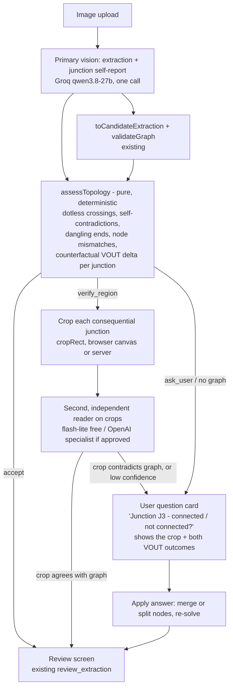

# Topology confidence / active verification (research, not shipped)

Branch `research/topology-confidence-moonshot`. Isolated from the release: nothing here is wired into a route, provider or the deployed app. Measured 2026-10-11, 12:45-12:53 PDT.

## TL;DR

- **Root problem:** a vision model's graph is a *conclusion*; it does not say *where* it made a judgement call. Groq qwen3.8-27b, with the production prompt, returned graphs with zero warnings on images that contain dot-less crossings (docs/DEMO_CASES.md, Groq-era rows 3, 4 and 6).
- **Free experiment (18 calls):** asking the same models to also list every junction (bbox, shape, dot present?, treated as connected?) plus dangling ends surfaced the hidden ambiguity on every ambiguous image Groq answered (3/3), with **0 false alarms on the 4 clean control reads** (fixtures 01, 03, both providers). Gemini 3.5-flash-lite missed the crossing on fixture 08 (1 false negative).
- **Crop verification works on our images:** 4/4 correct dot/no-dot plus connected/not-connected calls from flash-lite on 160 px crops, including the 08 crossing that flash-lite missed on the full image.
- **Deterministic layer:** a pure assessor (`src/lib/topology/crossings.ts`, 9 unit tests) turns the self-report into suspects, a counterfactual "does flipping this junction change VOUT?" number, and an escalation (`accept` / `verify_region` / `ask_user`).
- **Bug found on main (not fixed here, outside my scope):** `callGroq(step, instruction, ...)` in `src/lib/ai/groq.ts` **ignores `instruction`**. It always sends `EXTRACTION_PROMPT`. So the current `verify_topology` step (`src/lib/ai/secondary.ts`) never sends its "you are verifying... first pass: ..." prompt. It is a temperature-0 re-run of the same prompt on the same image, so it will almost always agree with the first pass.
- **Recommendation: continue research, ship after the hackathon. Not for today's freeze.** The prompt change costs about 4-5x more output tokens (211 → 645-1063), and 4 of 9 Groq calls hit 429 (8k TPM free tier). That is a demo-reliability risk.

## 1. Measured failure analysis

### Baseline (production prompt, from docs/DEMO_CASES.md)
Groq read `ambiguous-junction-groq.png` variants 3 times as graph + **no warnings, no unresolved** (review_extraction), and twice refused (graph null, ask_user). Graph + warnings never appeared, so Jev's `verify_topology` route never fired. Gemini-era 3.5-flash did warn on `ambiguous-junction.png`.

### Why graph validation cannot catch it
`validateGraph` checks GND present, measure node present, no floating nodes, kinds and values. The wrong reading of a dot-less crossing is still a valid divider:
- *open* reading: R1-R2 divider, VOUT = 2.5 V
- *joined* reading: VOUT shorted to GND, VOUT = 0 V

Both readings are physically consistent. Only the image can decide, so **no graph-only check can establish what the image connected.** The deterministic layer can only (a) notice when the model's own junction report contradicts its graph or the drawing convention, and (b) say whether the ambiguity *matters*, using the counterfactual solve.

### Free experiment: junction self-report
Prompt = production `EXTRACTION_PROMPT` + `CROSSING_REPORT_PROMPT` (junctions, danglingEnds, componentBoxes). Script: `scripts/topology-probe.mjs`. Sequential, one attempt per call, temperature 0, no Jev, no OpenAI.

| Image (ground truth) | Provider | Graph | Model warnings | Junction report found | Assessor escalation |
|---|---|---|---|---|---|
| 01 clean divider | groq | correct | 0 | 3 dotted tees | accept ✅ |
| 01 | gemini-3.5-flash-lite | correct | 0 | 3 dotted tees | accept ✅ |
| 03 series-parallel (dots) | groq | correct | 0 | 6 dotted | accept ✅ |
| 03 | flash-lite | correct | 0 | 6 dotted | accept ✅ |
| 08 GND wire crosses VOUT, no dot (open) | groq (2nd try; 1st 429) | correct | **0** | crossing J3 at the right spot, dot=false, but `treatedAsConnected: true` with nodes [VOUT, GND] (self-contradictory) | **verify_region** ✅ |
| 08 | flash-lite | correct | 0 | **missed the crossing**; listed a phantom dot | accept ❌ (false negative) |
| ambiguous-junction (crossing + 2 stubs) | groq | correct | **0** | crossing J3 [VOUT, GND] no dot, open; 2 dangling ends; counterfactual dV = **2.5 V** | **verify_region** ✅ |
| ambiguous-junction | flash-lite | correct | 2 | crossing (mislocated on the bottom rail), 2 dangling ends | verify_region ✅ |
| ambiguous-junction-groq (R2 lead through VOUT, no dot; stray cross; L stub) | groq (4th try; 3 x 429) | divider | **2 + 2 unresolved** | stray crossing, 4 dangling ends; called the R2 through-lead a "tee, no dot" but reported its dangling top end | verify_region ✅ |
| ambiguous-junction-groq | flash-lite | divider | 0 | stray crossing + 5 dangling ends (bbox numbers returned as strings, now coerced) | verify_region ✅ |

Scorecard over successful reads: ambiguity surfaced **5/6** (Groq 3/3, flash-lite 2/3), clean controls **4/4 accept**. Note the Groq 2+2 warnings on the last row: that is the first graph-plus-warnings Groq output we have seen. The prompt change alone might make Jev's verify_topology route reachable. That is a single observation (n=1), not a demonstrated stable property.

### Crop verification (flash-lite, 160x160 px crop upscaled to 480 px, centres from the generator coordinates)
| Crop | Truth | Answer | ms | tokens in/out |
|---|---|---|---|---|
| 01 dotted tee at VOUT | 3 arms, dot, connected | 3, dot, connected, conf 1.0 ✅ | 1539 | 1178/24 |
| 08 GND/VOUT crossing | 4 arms, no dot, open | 4, no dot, open, 0.95 ✅ | 2125 | 1178/27 |
| ambiguous-junction-groq R2 lead through VOUT | 4 arms, no dot (by convention open) | 4, no dot, open, 0.95 ✅ | 1013 | 1178/27 |
| ambiguous-junction-groq stray cross | 4 arms, no dot, open | 4, no dot, open, 0.95 ✅ | 2314 | 1178/27 |

The crop answer on the R2 through-lead contradicts the full-image graph, which joined R2 to VOUT. This is the kind of evidence-based disagreement that should escalate to the user. Caveat: 4 crops on synthetic renders. The prompt states the convention, so "connected" is essentially dot detection plus arm counting.

### Bounding boxes (item 6)
- **Groq:** junction and component boxes landed within about 15 px **once y is multiplied by W/H**. Groq returns both axes normalised by image *width*: VOUT dot at y = 120 px was reported at y = 0.15, and 0.15 x 820 = 123. That is a consistent bias, so it can be calibrated.
- **flash-lite:** about ±30 px on true junctions, but it also invented or misplaced junctions (phantom dot on 08; crossing put on the bottom rail of ambiguous-junction).
- Conclusion: model bboxes are good enough to *crop around* with a generous margin (`cropRect`, 6% margin). They are not good enough to trust as geometry. `sourceBoundingBox` on `CircuitComponent` can be filled from `componentBoxes` for UI highlighting. A classical line/dot detector is the post-hackathon upgrade for exact positions.

### Calls used: 18 of 20 budget
10 report calls (5 images x 2 providers) + 2 Groq retries + 1 more Groq retry + 1 final Groq retry + 4 crop calls. 4 of 9 Groq calls returned 429, even at 30-70 s gaps. Groq output grew from 211 to 645-1063 tokens with the junction audit, and its 8k TPM is likely shared with other agents. 0 Jev calls, 0 OpenAI calls.

## 2. Proposed architecture

Escalation rule (evidence-based, implemented in `assessTopology`):
- `verify_region`: a dot-less crossing the graph treats as joined, an unclear dot, or a dot-less crossing whose flip changes VOUT by more than 10 mV (or makes the circuit impossible, such as shorting the source). Report missing or malformed also counts.
- `ask_user`: no graph, or only dangling ends or node mismatches.
- `accept`: no suspects, or only dot-less crossings whose flip provably does not change VOUT.
- Recommended addition (not yet coded): also crop-verify every **dot-less tee** that sits next to a reported dangling end. On ambiguous-junction-groq, Groq mislabelled the 4-arm R2 through-lead as a tee but did report its dangling top end.

User question (item 4): one card per consequential junction, showing the crop, two buttons and the solver result for each choice ("Connected → VOUT 0 V · Not connected → VOUT 2.5 V"). The answer feeds into a node merge or split and a re-solve. A "not connected" answer needs to know which component terminals sit on which wire. That is easy from crops plus `componentBoxes`, and harder from the graph alone. `mergeDelta` covers the merge direction today.

## 3. OpenAI specialist option (research only; nothing called)

Official sources read 2026-10-11 (the pricing page shows no "last updated" date):
- Pricing (developers.openai.com/api/docs/pricing, standard tier, per 1M tokens, input / output): gpt-5.4 $2.50 / $15.00; gpt-5.4-mini $0.75 / $4.50; gpt-5.4-nano $0.20 / $1.25; gpt-5.6-luna $0.20 / $1.20; gpt-5.6-terra $2 / $12; gpt-4.1-mini $0.40 / $1.60; gpt-4o $2.50 / $10.
- Image input (developers.openai.com/api/docs/guides/images-vision): the vision-capable list includes gpt-5.4, gpt-5.4-mini, gpt-5.4-nano, the gpt-5.6 family, gpt-4.1-mini and gpt-4o. Patch billing: `ceil(w/32) * ceil(h/32)` patches x 1.2 multiplier for gpt-5.x (1.62 for gpt-4.1-mini). For our 820x460 PNG that is 26 x 15 = 390 patches → **468 tokens**; a 480x480 crop → 225 patches → **270 tokens**. Image tokens count toward TPM.
- Structured outputs: `json_schema` with strict mode is documented for gpt-4o-2024-08-06 / gpt-4o-mini "and later". Its reliability *with image input* on the newer models is not stated on the page I read, so it is **unverified**.
- Latency: **not measured** (no calls made).
- Spend controls (developers.openai.com/api/docs/guides/spend-limits): project hard limits (requests fail with 429 `project_spend_limit_exceeded`), org limits, spend alerts, and prepaid credits (`credit_balance_exhausted` when empty). Prepaid auto-recharge exists as an optional setting; it must be **off**. The minimum prepaid purchase is $5.
- ChatGPT subscription ≠ API credit: these are separate billing systems. A ChatGPT Plus/Pro plan does not fund API calls. I could not fetch the official help article (403), so I am relying on the help-center search summary. The owner's "~$100 API credit" is **unverified**: check platform.openai.com → Billing (API org), not the ChatGPT account.

### ≤ $1 test plan (AWAITING OWNER APPROVAL; do not run without it)
Preconditions: a dedicated API project with a **$1 hard limit**, auto-recharge **off**, a key in `.env.local` only (server-side), `max_output_tokens` 1500 (full image) / 300 (crop), and low reasoning effort where supported. Sequential, one attempt each, no retries.

| Step | Model | Calls | Est. tokens per call (in / out, incl. reasoning) | Est. cost per call | Subtotal |
|---|---|---|---|---|---|
| A. Full-image extraction + junction report (01, 03, 08, ambiguous-junction, ambiguous-junction-groq) | gpt-5.4-mini | 5 | 2,000 / 1,500 | $0.0083 | $0.042 |
| B. Same 5 images | gpt-5.4 | 5 | 2,000 / 1,500 | $0.0275 | $0.138 |
| C. Crop verification (the 4 crops above + 2 crops cut from model bboxes) | gpt-5.4-mini | 6 | 500 / 300 | $0.0017 | $0.010 |
| D. Same 6 crops | gpt-5.4 | 6 | 500 / 300 | $0.0058 | $0.035 |
| **Total** | | **22** | | | **≈ $0.23 (worst case with the output caps: ≈ $0.30)** |

Success criteria: schema-valid on 22/22 calls, crossing found on 08 and on both ambiguous samples, 0 false flags on 01/03, crop answers 6/6, and measured p50 latency below 4 s. The $1 hard limit stops anything beyond that.

## 4. Proof of concept on this branch
- `src/lib/topology/crossings.ts`: `CROSSING_REPORT_PROMPT`, a lenient zod `junctionReportSchema`, `assessTopology` (pure), `mergeDelta` (counterfactual solve via the existing `solveDC`), and `cropRect`. It is not imported by any route.
- `tests/topology/crossings.test.ts`: 9 tests (clean accept, Groq-08 self-contradiction, 2.5 V counterfactual, harmless crossing, string bboxes, malformed report, node mismatch, source-short = Infinity, crop clamping).
- `scripts/topology-probe.mjs`: the free experiment (`report`, `crop`, and an offline `reassess` that makes no API calls).

## 5. Complexity estimate and production roadmap
| Phase | Work | Estimate |
|---|---|---|
| 0 (fix on main, small) | Make `callGroq` send its `instruction` so `verify_topology` actually verifies (one-line change plus a test). Release-captain decision. | 15 min |
| 1 | Junction audit behind a flag (`TOPOLOGY_AUDIT=1`). Push suspects into `warnings`/`unresolvedConnections` so Jev sees them. Measure the Groq 429 rate over 10 runs before enabling. | 0.5 day |
| 2 | Crop verification of `verify_region` suspects (crop in the browser with canvas to avoid a server image dependency; flash-lite reads the crops) | 0.5-1 day |
| 3 | Junction question card + merge/split re-solve, and highlighting from `sourceBoundingBox` | 1 day |
| 4 | Labelled real-photo eval set (20-50 hand-drawn/photographed circuits), then compare flash-lite vs OpenAI specialist on crops | 1-2 days + owner-approved spend |
| 5 | Classical dot/line detector (OpenCV-style Hough plus blob detection) as a model-independent second witness | 2-3 days |

## 6. Recommendation
**Continue research; ship later (post-hackathon). Do not merge before the 3:30 PM freeze.**
- Promising, measured: the junction self-report surfaced the hidden ambiguity on every ambiguous image Groq answered (3/3), with no false alarms on clean controls. Crop checks were 4/4.
- Not demo-safe today: the evidence is n=1 per cell on synthetic images, with 4 of 9 Groq calls rate-limited under the larger output, and one flash-lite false negative.
- The highest-value, lowest-risk item is the `callGroq` instruction bug (Phase 0). Without that fix, the existing verify_topology step cannot provide an independent check even when Jev routes to it.
