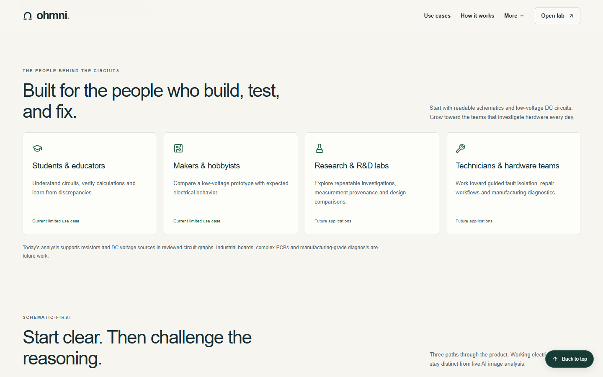
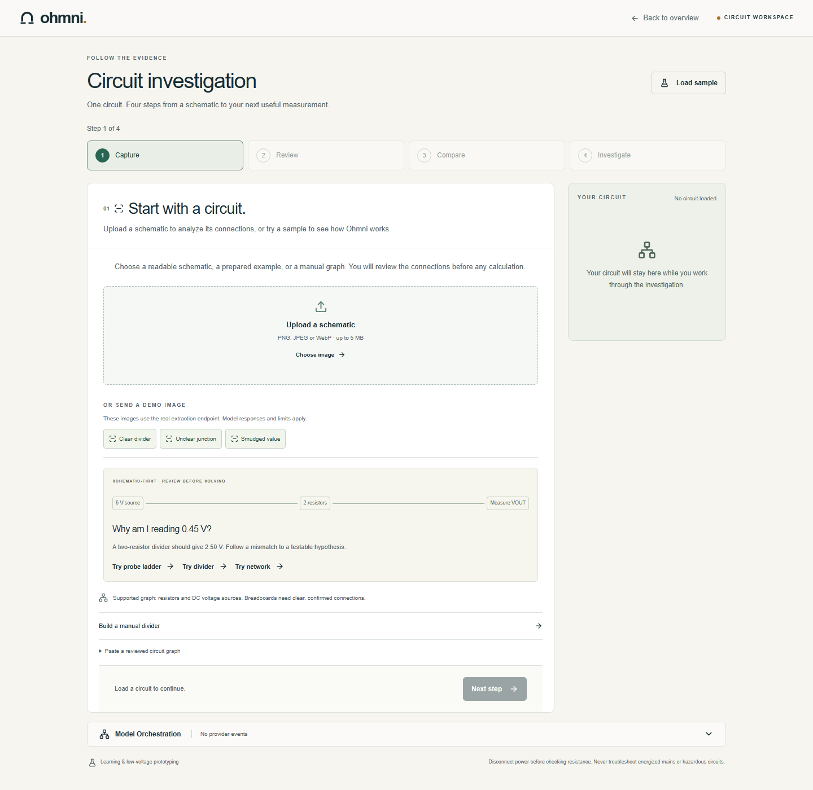
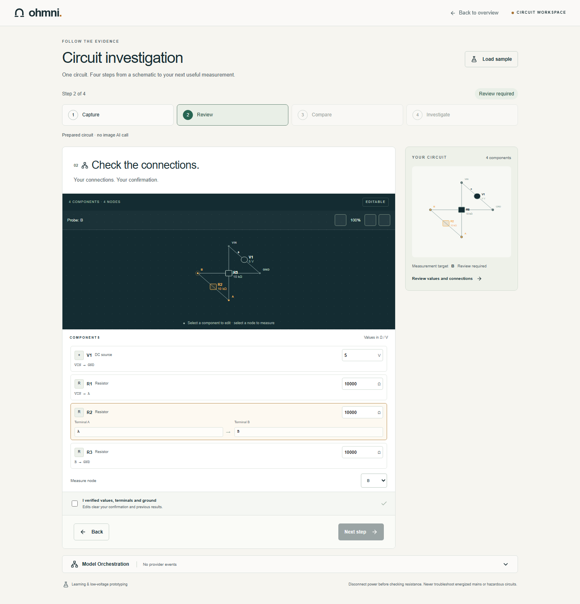
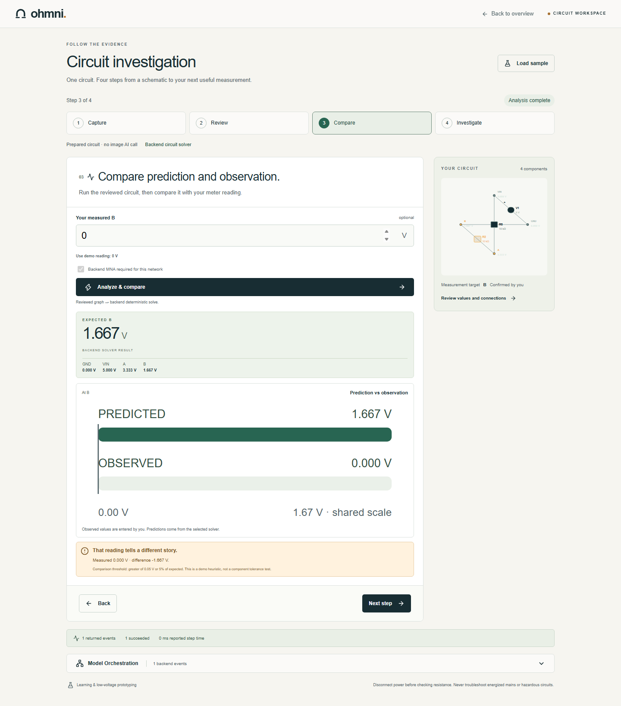
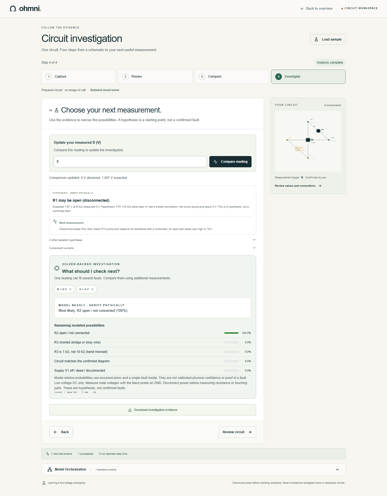
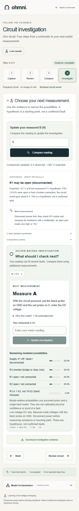
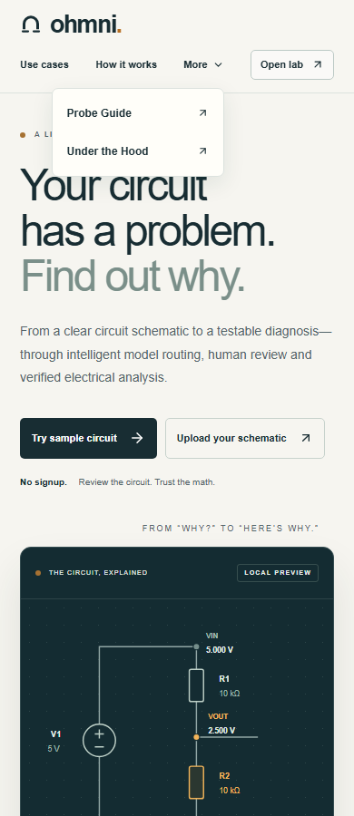

# Guided circuit investigation

Follow-up base: `bd6c3ccbfd66a30462d8a1ee95358d4c638494f3` (main after Claude merged PR #49 and closed duplicate PR #48). The published redesign passed Linux CI including the production build. These additional review fixes require a separate PR and fresh CI run after publication.

The homepage now has a compact sticky header, no reading-progress line, and an audience section between How it works and the roadmap. Current limited DC uses and future lab/technician applications are explicitly distinguished.

The lab presents Capture → Review → Compare → Investigate in one prominent frame. Desktop keeps a small circuit preview alongside the frame; mobile shows the active stage at full width. The idle session banner is removed. Status labels describe extraction, required review, confirmation and completed analysis.

## Gates and retained behavior

- A loaded graph unlocks Review. A valid graph, acknowledged ambiguities and explicit human confirmation unlock Compare. An actual result unlocks Investigate.
- Back navigation preserves the circuit, result and probe history. Changing values, terminals, measurement target or confirmation clears results and probe state. Changing the graph also clears ambiguity acknowledgements. Replacing the source resets the investigation.
- Stage transitions focus the heading and scroll the stage navigation into view. Hidden frames retain inputs but are excluded from display, keyboard navigation and the accessibility tree.
- The existing extraction, routing, solver and probe endpoints and canonical contracts are unchanged. Source images can be inspected during Review. Manual graph recovery, optional readings, backend/local-divider selection, probe undo, evidence export and returned execution traces remain available.
- Investigate accepts a new or updated meter reading directly. Submitting it uses the existing solve endpoint and stays in Investigate, with confirmation still required. Failed comparisons retain the draft for retry. A successful new comparison replaces prior probe history.
- A passive source label distinguishes prepared/manual/imported graphs from uploaded schematics. Returned calculations retain an always-visible backend/local source label. Errors scroll into view and offer recovery wording appropriate to the active stage.
- The compact homepage header keeps Use cases, How it works and Open lab visible. A native More disclosure groups the shipped Probe Guide and Under the Hood pages, with a single primary navigation row at 320 and 390 px.
- No advanced dashboard mode is included in this submission change.

## Validation

Local component browser QA: **138 assertions passed**, at 320, 390, 768 and 1440 px, with zero browser runtime errors. Actual unchanged `/api/solve` and `/api/probe` route handlers ran through a temporary Vite middleware; Next link/search-parameter adapters and the handwritten stylesheet were used. This is component/integration evidence, not a successful Next production build.

Verified numerical results: divider 2.500 V; edited divider 0.455 V; ladder B 1.667 V; edited ladder B 2.381 V; series/parallel network MID 6.545 V. The actual probe endpoint chose A after B = 0 V, narrowed to R2 open after A = 5 V, and recalculated after undo.

The browser checks also cover sticky positioning after scrolling; all three homepage navigation links; audience order and status labels; four-stage gates; keyboard focus; one visible frame; back/forward probe preservation; edit invalidation; direct entry without a prior reading and matching-reading notices; downloaded evidence; source review; manual recovery; and horizontal overflow across all four stages.

Review-fix coverage adds direct entry and updates of readings in Investigate, the exact submitted measurement in the real solver request, retry after a simulated failure, clearing stale probe state after a matching reading, always-visible backend/local provenance, and resetting from a completed investigation. The current main integration changes additional routes and their tests; it does not change the lab, homepage or numerical handlers used in the component browser checks.

Navigation coverage verifies both secondary destinations, bounds of the expanded disclosure, and the primary row height at every tested width. Page implementations are the already merged routes from PRs #47 and #50.

Extraction uncertainty and provider-unavailable cases, plus HTTP 429/413/503 failures, are **explicit browser fixtures**. They verify recovery and confirmation behavior without consuming live model calls. No new live provider success or extraction quality claim is made.

Local UI ESLint (including the smoke script) and TypeScript checks pass; **147 unit tests pass across 17 files** on this updated base. The Windows production build is blocked before application compilation by native SWC's access-denied error while canonicalizing the workspace to load `next.config.ts`. The normal Linux CI must pass lint, generated types, unit tests and the full production build before merge. A deployed preview should also be checked before release.

## Reproduce browser checks on Next

The durable smoke script is `scripts/guided-ui-smoke.mjs`. Run against an already running development server or the PR preview. Playwright is a QA prerequisite, not an added application dependency:

```sh
npm install --no-save --package-lock=false playwright
npx playwright install chromium
BASE_URL=http://localhost:3000 node scripts/guided-ui-smoke.mjs
```

On PowerShell, set `$env:BASE_URL` before running the script. Optional `GUIDED_PLAYWRIGHT_MODULE` and `GUIDED_BROWSER_EXECUTABLE` select an existing test runtime. `GUIDED_UI_OUTPUT_DIR` selects the results/screenshot directory (default `work/guided-ui`). Use a disposable test checkout and do not commit generated runtime files. Solve/probe requests are real; extraction and error responses are intentionally mocked.

## Local component screenshots








