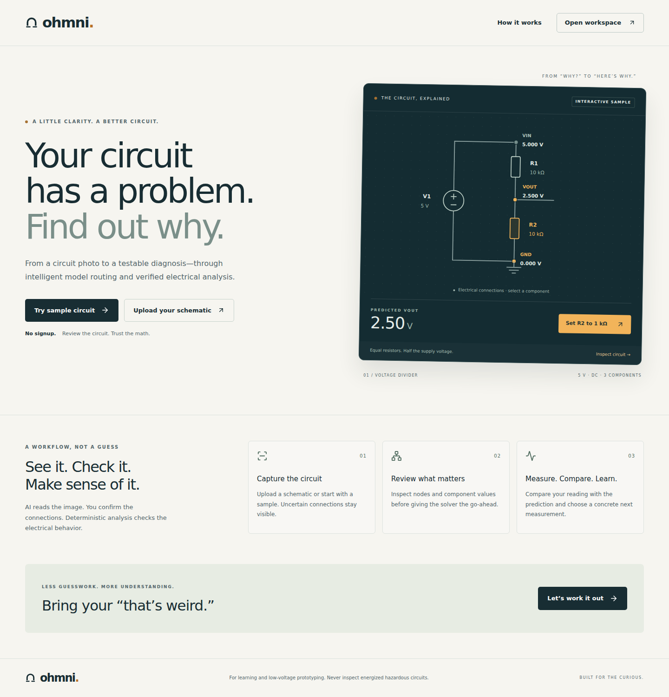
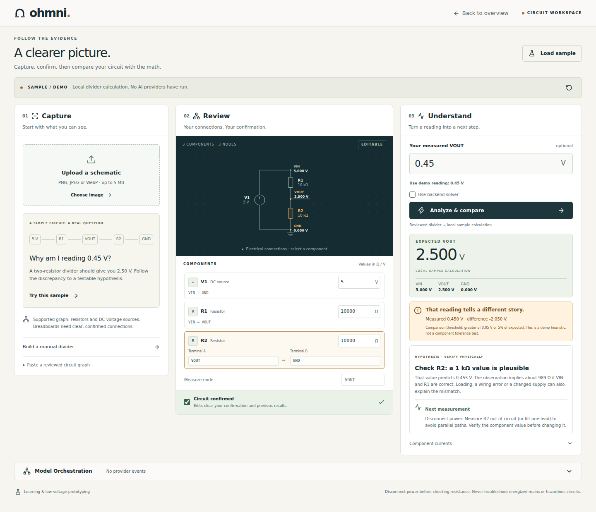
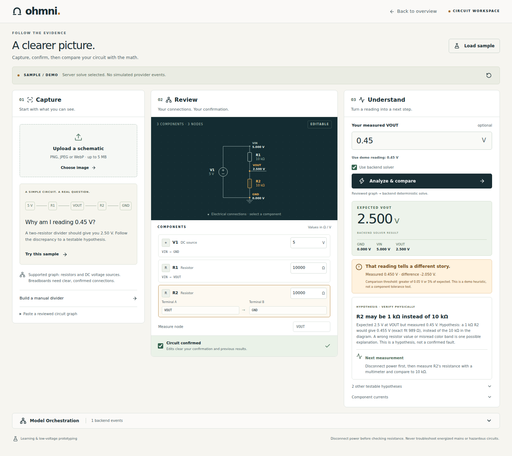

# Ohmni UI review evidence

Captured from the production Next.js 16.4.0 build in a headless Chromium browser. The default sample uses the real backend MNA solver. The original screenshots show explicitly labeled local fallback calculations; lab-backend-desktop.png shows the actual server result. No screenshot is evidence of a successful live vision/decision-provider call.

## Validation

- `npm run typecheck`: passed.
- `npm run build`: passed with the actual repo configuration (cache components and partial prefetching enabled).
- UI-scoped ESLint with `--max-warnings 0`: passed.
- Repository unit tests: 75/75 passed after integration with current main.
- Six numeric/contract assertions: 2.500 V divider, 5/11 V with R2=1k, 1k hypothesis, invalid resistor, nonfinite solver output, malformed extraction.
- Browser flows and viewport checks: see browser-checks.json.
- Axe accessibility: see accessibility-checks.json (landing, empty lab, solved lab). Automated checks do not replace a manual accessibility audit.

## Integration gates

The coordinator added lucide-react on main in PR #11. The UI branch was updated onto main with the real extraction, solver and diagnosis handlers; no root/shared/backend files are modified by this UI PR. Samples clone the backend-owned DIVIDER_10K_10K fixture, and the backend solver is selected by default. Uncheck Use backend solver for a clearly labeled local fallback.

Actual local production API verification passed: 2.500 V result, R2 may be 1k hypothesis, backend recomputation to 0.455 V, returned local/mna-dc trace. The real extraction handler returned GEMINI_NOT_CONFIGURED; image preservation and manual fallback worked. This is not proof of a live Gemini or Jev call.

### Resumed verification — 2026-10-11

Rebased the existing UI PR onto main `2bd7bcec668059730ebaa15f9e1598a144c4260b`, including the coordinator's BeatAPI free-model routing changes. Tested implementation SHA: `fcb39c2181bca8c751ba10efeaaeb911e5be3dfc`. Full repository lint, typecheck, 75 tests and production build passed. The real production-handler Chromium flow passed all seven assertions in backend-integration-checks.json, including 2.500 V, the R2 hypothesis, 0.455 V after editing, actual solver trace and explicit extraction failure without configured Gemini. Previous viewport/accessibility checks are retained; they were not rerun because the UI implementation is unchanged by this rebase. No live provider or deployment success is claimed.

Upload uses multipart field `image` at POST /api/extract. Solve uses `{graph,userConfirmed:true,measuredVoltage?}` at POST /api/solve. Both paths validate returned data, time out after 30 seconds and fail visibly. Arbitrary graphs never use the local divider calculation.

## Three-minute sample demo

1. Landing: select R2; toggle between 10k and 1k.
2. Try sample; enter 0.45 V; review and confirm.
3. Analyze: expected 2.500 V, mismatch, plausible 1k R2.
4. Read the power-disconnected resistance check.
5. Change R2 to 1000 Ω; reconfirm; see 0.455 V and close agreement.
6. Expand Model Orchestration: actual backend solver trace, with no invented provider calls.

## Screenshots

[Mobile landing](landing-mobile.png) · [Mobile workspace](lab-mobile.png)

[Actual backend integration checks](backend-integration-checks.json)
